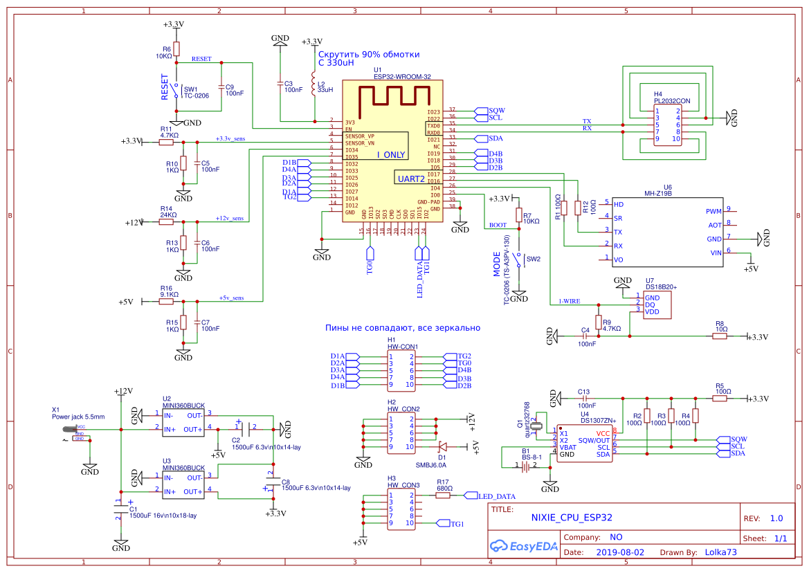

# NixieClock formware on Rust
Based on https://github.com/ImplFerris/esp32-projects/tree/main/webserver-html

## Схема

| IO PIN | Цепь                  | Назначение                      |
| ------ | --------------------- | ------------------------------- |
|        | *ADC*                 |                                 |
| 39     | 3.3v_sens             | Измерение напряжения 3,3 В     |
| 34     | 12v_sens              | Измерение напряжения 12 В       |
| 35     | 5v_sens               | Измерение напряжения 5 В        |
|        | *Monitor UART*        |                                 |
| RX0    | RX                    | UART0 RXD                       |
| TX0    | TX                    | UART0 TXD                       |
|        | *MH-Z19 UART*         |                                 |
| 16     | RX                    | UART2 RXD                       |
| 17     | TX                    | UART2 TXD                       |
|        | *Temperature sensor*  |                                 |
| 4      | 1-Wire                | 1-Wire data                     |
|        | *Buttons*             |                                 |
| EN     | RESET                 | Кнопка сброса                   |
| 0      | MODE                  | Кнопка режима                   |
|        | *Neopixel*            |                                 |
| 15     | LED_DATA              | Данные для адресных светодиодов |
|        | *RTC*                 |                                 |
| 21     | SDA                   | RTC I2C SDA                     |
| 22     | SCL                   | RTC I2C SCL                     |
| 23     | SQW                   | RTC импульс с периодом 1 с.     |
|        | *Nixie Tubes control* |                                 |
| 13     | TG0                   | Выбор лампы 0                   |
| 2      | TG1                   | Выбор лампы 1                   |
| 14     | TG2                   | Выбор лампы 2                   |
| 27     | D1A                   | Данные для группы ламп A бит 0  |
| 26     | D2A                   | Данные для группы ламп A бит 1  |
| 25     | D3A                   | Данные для группы ламп A бит 2  |
| 33     | D4A                   | Данные для группы ламп A бит 3  |
| 32     | D1B                   | Данные для группы ламп B бит 0  |
| 5      | D2B                   | Данные для группы ламп B бит 1  |
| 18     | D3B                   | Данные для группы ламп B бит 2  |
| 19     | D4B                   | Данные для группы ламп B бит 3  |
