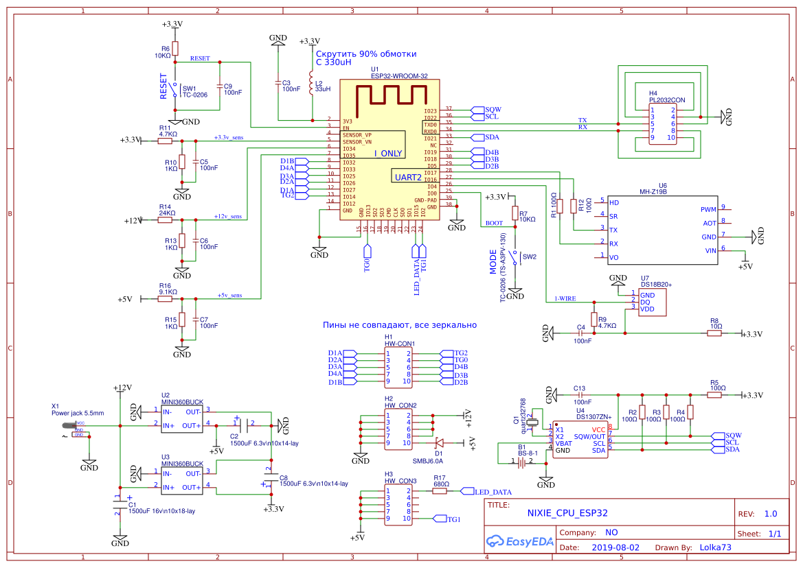

# NixieClock-ESP32-rs

Порт часов на Nixie-лампах (ESP32) с C++/ESP-IDF (Home/NixieClock-ESP32-idf) на Rust.
OTA/rollback-база — проверенный шаблон Home/esp32-ota-template (esp-hal 1.2.2, esp-radio, embassy-net, esp-bootloader-esp-idf с auto-rollback).

Ветка `legacy-2025` — прежний незавершённый порт (esp-hal 1.0.0-beta.0). Ветка `rewrite` — текущая работа.

## Схема

| IO PIN | Цепь                  | Назначение                      |
| ------ | --------------------- | ------------------------------- |
|        | *ADC*                 |                                 |
| 33     | 3.3v_sens             | Измерение напряжения 3,3 В      |
| 34     | 12v_sens              | Измерение напряжения 12 В       |
| 35     | 5v_sens               | Измерение напряжения 5 В        |
|        | *Monitor UART*        |                                 |
| RX0    | RX                    | UART0 RXD                       |
| TX0    | TX                    | UART0 TXD                       |
|        | *MH-Z19 UART*         |                                 |
| 16     | RX                    | UART2 RXD                       |
| 17     | TX                    | UART2 TXD                       |
|        | *Temperature sensor*  |                                 |
| 4      | 1-Wire                | 1-Wire data                     |
|        | *Buttons*             |                                 |
| EN     | RESET                 | Кнопка сброса                   |
| 0      | MODE                  | Кнопка режима                   |
|        | *Neopixel*            |                                 |
| 15     | LED_DATA              | Данные для адресных светодиодов |
|        | *RTC*                 |                                 |
| 21     | SDA                   | RTC I2C SDA                     |
| 22     | SCL                   | RTC I2C SCL                     |
| 23     | SQW                   | RTC импульс с периодом 1 с.     |
|        | *Nixie Tubes control* |                                 |
| 13     | TG0                   | Выбор лампы 0                   |
| 2      | TG1                   | Выбор лампы 1                   |
| 14     | TG2                   | Выбор лампы 2                   |
| 27     | D1A                   | Данные для группы ламп A бит 0  |
| 26     | D2A                   | Данные для группы ламп A бит 1  |
| 25     | D3A                   | Данные для группы ламп A бит 2  |
| 33     | D4A                   | Данные для группы ламп A бит 3  |
| 32     | D1B                   | Данные для группы ламп B бит 0  |
| 5      | D2B                   | Данные для группы ламп B бит 1  |
| 18     | D3B                   | Данные для группы ламп B бит 2  |
| 19     | D4B                   | Данные для группы ламп B бит 3  |

## Структура (cargo workspace)

- `core/` (`clock-core`) — `no_std` бизнес-логика без железа: модель времени, настройки, `framebuffer` дисплея, кодирование ламп. Хост-тесты: `cargo test -p clock-core` (x86, в CI).
- `firmware/` (`nixieclock-firmware`) — esp-бинарь: WiFi STA+fallback AP, HTTP-страница настроек, OTA с rollback-guard, логи по WiFi, RTC DS1307, датчики, драйвер индикации.
- `tools/ci_build.sh` — сборка + `espflash save-image` (app-only) + проверка OTA-образа (гейт размера слота 0xE0000 — флеш платы 2MB).
- `partitions_2mb.csv` — фактическая разметка платы (nvs/otadata/ota_0@0x20000/ota_1@0x100000, слоты 0xE0000); `partitions_4mb.csv` — эталонная 4MB.
- `HARDWARE.md`, `Schematic-lv.png` — паспорт железа оригинальных часов (пины, схема).

## Железо (ESP32 classic v1.0, 2MB flash, без PSRAM, без сдвиговых регистров)

- **Индикация — подтверждено владельцем (2026-11-13), опорная истина для M6:**
  - Дешифраторов **два**, модель **К155ИД1** (советский аналог 74141, выходы **0..9**). К каждому подключены по **3 лампы ИН-14**; катод лампы — форма целой цифры. Шина A GPIO27/26/25/33 → лампы 1–3 (декодер A), шина B GPIO32/**5**/18/19 → лампы 4–6 (декодер B). Примечание: оригинальная прошивка вела D2B на GPIO12 (`Nixie.cpp:27`, комментарий `// 5 // D2B`), хотя по схеме это GPIO5 (VSPI_CS; безопасен — TTL-вход дешифратора держит HIGH при загрузке). Для порта D2B = GPIO5; GPIO12 (VDD_SDIO, требует LOW при загрузке) развязывается.
  - Карта `0→3, 1→2, 2→4, 3→1, 4→8, 5→13, 6→5, 7→12, 8→9, 9→0, гашение→10` — цифра→физический катод/выход: нужна потому, что для упрощения разводки **номера катодов на плате не соответствуют выходам дешифратора**. Гашение `10` согласуется с К155ИД1: нет подходящего выхода → лампа не горит. ⚠️ Коды `5→13`/`7→12` вне диапазона выходов 0..9 — точную проводку этих двух цифр восстановить по схеме платы на этапе M6.
  - Стробы **TG0/TG1/TG2** (GPIO13/2/14): цепочка транзисторов **PZTA42T1G → PZTA92T1G**, включают **катоды** (не аноды). Активный уровень **HIGH**.
  - Соответствие TG разрядам `01 20 12` (ЧЧ ММ СС): Ч1→TG0, Ч2→TG1, М1→TG2, М2→TG0, С1→TG1, С2→TG2. Такт: на шину A — код разряда g, на шину B — код g+3, one-hot TG_g; в каждый момент горят 2 лампы.
  - Частота ~400 Гц/лампа (~832 мкс/слот) нужна для **плавного кросс-фейда** — имитация медленного розжига резистивных сегментов ламп.
  - У ламп **послесвечение** (заметно на Ч и М) → между слотами нужна **blank-пауза**, длительность подбирается в тактах на живом железе (M6).
  - Стратегия порта: DMA-обновление 8 линий данных (LCD-mode 8 lanes + WS), стробы — по результату probe. Сдвиговых регистров на плате нет и не добавляем.
- RTC DS1307: I2C SDA=21 SCL=22, SQW 1Гц → GPIO23. DS18x20: GPIO4. MH-Z19 CO2: UART2 TX=17 RX=16 @9600. NeoPixel 6px: GPIO15. Кнопка: GPIO0. Напряжения 3.3/5/12V: ADC GPIO39/35/34.
- Консоль/логи: UART0 (TX1/RX3) + POST на коллектор `http://AAA.BBB.CCC.DDD/logs`.

## Сборка

Тулчейн espup (`cargo +esp`), target `xtensa-esp32-none-elf` (см. [firmware/.cargo/config.toml](firmware/.cargo/config.toml)).
`SSID`/`PASSWORD`/`LOG_URL` — через env ([env] в config.toml — плейсхолдеры для локальных сборок; реальные креды - инжектит CI).
`bash tools/ci_build.sh` → `dist/app.elf` + `dist/app_ota.bin` + `dist/sha256.txt`.

## Выкатка на плату (2MB-разметка уже в flash, загрузчик с rollback прошит)

1. CI/локально собирается app-only образ (magic E9, ≤ 917504 B).
2. Кладётся на OTA-сервер (VM `AAA.BBB.CCC.DDD:8000`).
3. Плата: `GET /ota?url=...` (текущее демо) или `POST /api/ota {"url":...}` (новая прошивка) → слот → PendingVerify → confirm после диагностики → Valid; падение — авто-откат.

## roadmap

M0 каркас/CI → M1 сеть+HTTP+HTML-страница → M2 OTA нового приложения + rollback → M3 NVS+кнопка → M4 DS1307+NTP → M5 индикация (DMA/probe-результат) → M6 датчики.
